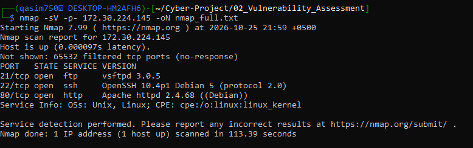
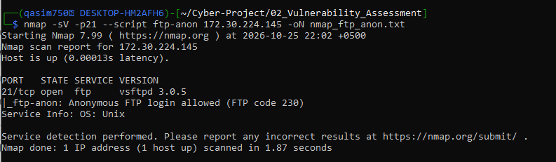
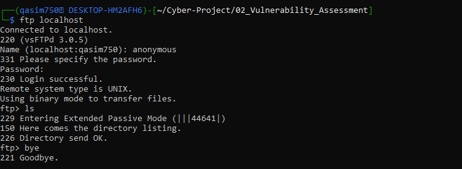
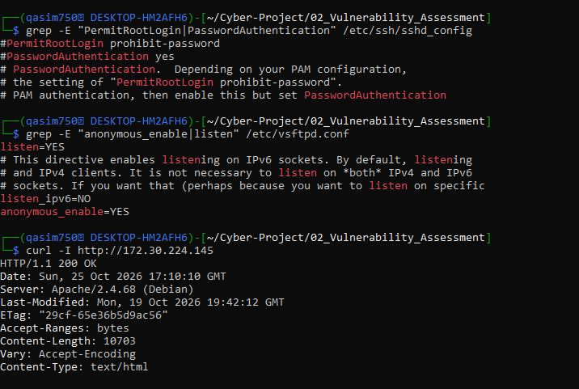
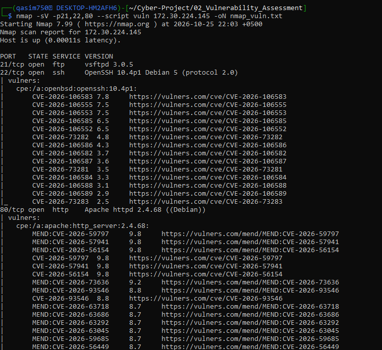
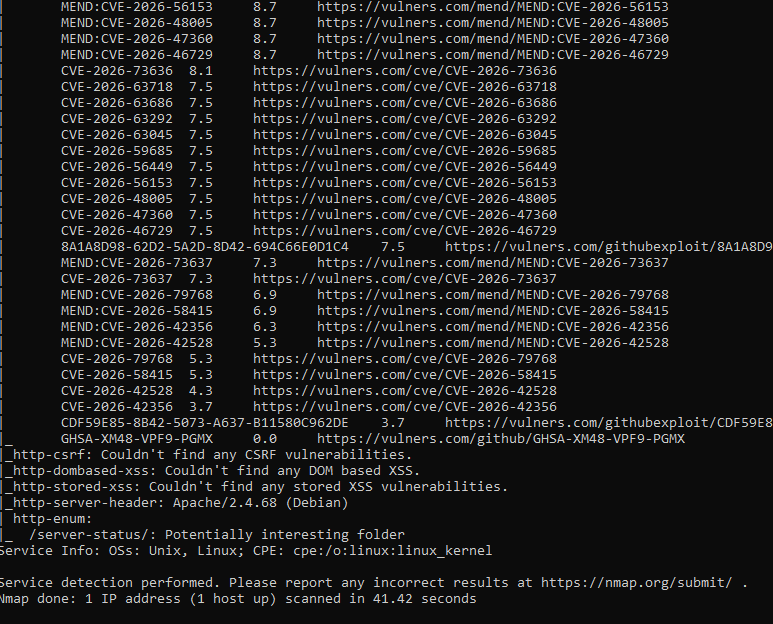
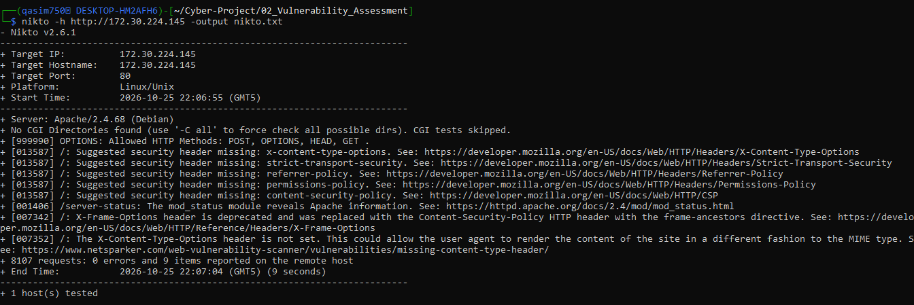
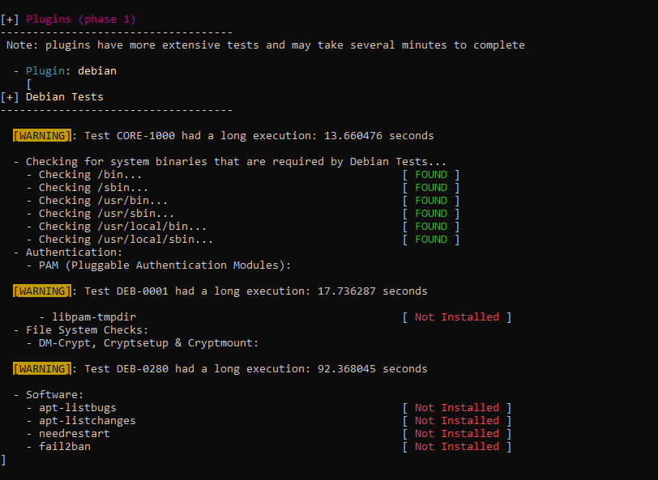
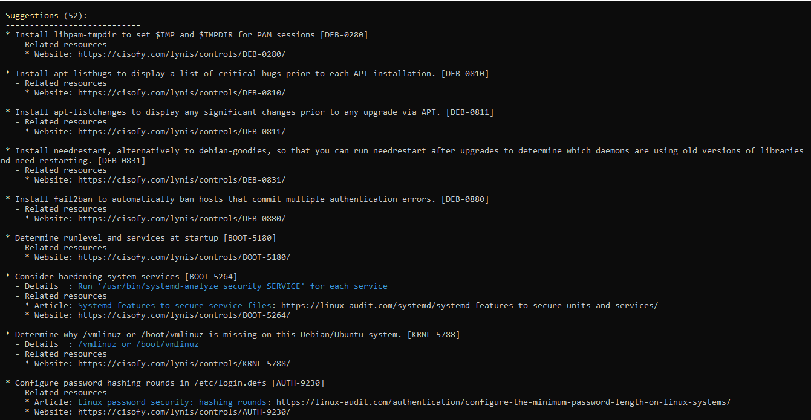

# Week 2: Vulnerability Assessment Report

**Program:** Verstech Internship Program, Track 11 (Cybersecurity Assessment)
**Author:** Qasim Mujahid
**Date of assessment:** 25 October 2026
**Classification:** Confidential (own lab, no real data)

---

## 1. Executive Summary

A vulnerability assessment was performed on one Linux host: my own Kali Linux instance running under WSL. Three services were installed and exposed to create a realistic target: FTP (vsftpd), SSH (OpenSSH) and a web server (Apache). The full TCP port range was scanned, followed by a web server review (Nikto) and a configuration audit (Lynis).

**Result:** 12 findings (High 1, Medium 4, Low 7).

- **Anonymous FTP login is enabled** and was confirmed by a real login.
- **Apache 2.4.68 is outdated.** Apache 2.4.69 fixes many vulnerabilities, three of them rated CVSS 9.8. Whether each one is exploitable here depends on which Apache modules are loaded.
- **OpenSSH 10.4p1 is affected** by a group of CVEs fixed in OpenSSH 10.6. Most are client-side or need non-default options.
- The host uses **no HTTPS**, has **no active firewall rules**, and has weak logging and brute-force protection.
- Lynis gave a **hardening index of 61/100** (3 warnings, 52 suggestions).

**Top actions:** disable anonymous FTP, upgrade Apache and OpenSSH when patched packages are available, enable HTTPS, add firewall rules (default deny), and install brute-force protection.

---

## 2. Scope and Authorization

| Item | Detail |
|---|---|
| Target | Kali Linux (WSL) instance, IP `172.30.224.145` |
| In scope | Ports and services on this single host |
| Out of scope | Every other system (college network, home router, any public website) |
| Authorization | The target is my own machine. All services were installed by me for this lab. |
| Environment | Local, isolated lab. No real personal data. |

**Limitations**
- The target is a WSL instance, so 65,532 ports appear as "filtered" because of WSL networking.
- Scans were run from the same machine as the target.
- OpenVAS/Nessus were not used because of WSL resource limits. Nmap NSE, Nikto and Lynis were used instead.
- Lynis was run on WSL, so some suggestions (for example missing `/vmlinuz`, separate partitions) are WSL-specific and were not counted as findings.
- Nmap's `vulners` script matches CVEs by version string only. Each CVE below was checked against vendor and Debian advisories, but exploitability was **not** tested (this is an assessment, not a penetration test).

---

## 3. Method

Process: **Scope → Discover → Scan → Analyze → Rate risk → Report → Retest**

| Step | Tool | Command |
|---|---|---|
| Port and service discovery | Nmap 7.99 | `nmap -sV -p- 172.30.224.145 -oN nmap_full.txt` |
| Anonymous FTP check | Nmap NSE | `nmap -sV -p21 --script ftp-anon 172.30.224.145 -oN nmap_ftp_anon.txt` |
| Vulnerability scripts | Nmap NSE (`vuln`, `vulners`) | `nmap -sV -p21,22,80 --script vuln 172.30.224.145 -oN nmap_vuln.txt` |
| Web server review | Nikto 2.6.1 | `nikto -h http://172.30.224.145 -output nikto.txt` |
| Manual checks | ftp, grep, curl | `ftp localhost`, `grep` on config files, `curl -I http://172.30.224.145` |
| Configuration audit | Lynis 3.1.6 | `sudo lynis audit system \| tee lynis_output.txt` |
| CVE lookup | NVD, Apache and OpenSSH advisories, Debian Security Tracker | |

| CVSS score | Severity |
|---|---|
| 9.0 to 10.0 | Critical |
| 7.0 to 8.9 | High |
| 4.0 to 6.9 | Medium |
| 0.1 to 3.9 | Low |

Severity in this report is the **contextual rating** (CVSS plus how likely the issue is in this lab and what would be lost).

---

## 4. Discovery Results

All 65,535 TCP ports were scanned (about 114 seconds). Three ports are open:

| Port | Service | Version |
|---|---|---|
| 21/tcp | FTP | vsftpd 3.0.5 |
| 22/tcp | SSH | OpenSSH 10.4p1 Debian 5 (protocol 2.0) |
| 80/tcp | HTTP | Apache httpd 2.4.68 (Debian) |

Evidence: `screenshots/01_nmap_full.png`

**Screenshot: Nmap full port scan**



---

## 5. Findings Summary

| ID | Title | Asset | Severity | Status |
|---|---|---|---|---|
| VULN-01 | Anonymous FTP login enabled | :21 | Medium | Open |
| VULN-02 | Outdated Apache (2.4.68) affected by multiple CVEs | :80 | High | Open |
| VULN-03 | OpenSSH 10.4p1 affected by CVEs fixed in 10.6 | :22 | Medium | Open |
| VULN-04 | No HTTPS; FTP and HTTP unencrypted | :80, :21 | Medium | Open |
| VULN-05 | No active host firewall rules | host | Medium | Open |
| VULN-06 | SSH password login enabled, no brute-force protection | :22 | Low | Open |
| VULN-07 | Missing HTTP security headers | :80 | Low | Open |
| VULN-08 | Server version disclosure | :21, :22, :80 | Low | Open |
| VULN-09 | Apache `/server-status` reachable | :80 | Low | Open |
| VULN-10 | Weak logging and monitoring | host | Low | Open |
| VULN-11 | Password policy not configured | host | Low | Open |
| VULN-12 | Unneeded packages and risky PHP setting | host | Low | Open |

**Count by severity:** Critical 0, High 1, Medium 4, Low 7.

---

## 6. Detailed Findings

### VULN-01: Anonymous FTP login enabled
- **Asset:** 172.30.224.145, port 21 (vsftpd 3.0.5)
- **Description:** The FTP server accepts the `anonymous` user without a real account (`anonymous_enable=YES`, set deliberately for this lab).
- **Evidence:** Nmap `ftp-anon`: "Anonymous FTP login allowed (FTP code 230)" (`02_ftp_anon.png`). A manual login succeeded and directory listing worked (`06_ftp_login.png`). Config shown in `07_config_check.png`.

**Screenshot: Nmap ftp-anon result**



**Screenshot: Anonymous FTP login**



**Screenshot: Config check (sshd, vsftpd, curl -I)**


- **Impact:** Anyone who can reach the server can list files and possibly download them. Write access was not tested.
- **Severity:** Medium (High if anonymous users could upload files).
- **Recommendation:** Set `anonymous_enable=NO` in `/etc/vsftpd.conf` and restart vsftpd. Prefer SFTP.

### VULN-02: Outdated Apache (2.4.68) affected by multiple CVEs
- **Asset:** Apache httpd 2.4.68 (Debian), port 80
- **Description:** Apache HTTP Server 2.4.69 fixes many vulnerabilities affecting 2.4.0 through 2.4.68 (14 to 20 depending on the advisory). Three are rated CVSS 9.8:
  - CVE-2026-59797: improper privilege management in `mod_ssl` (`SSLRequire`)
  - CVE-2026-57941: use-after-free in `mod_http2`
  - CVE-2026-56154: use-after-free in `mod_rewrite`

  High-rated examples: CVE-2026-93546 (`mod_dav_fs`, 8.8), CVE-2026-73636 (`mod_auth_digest`, 8.1).
- **Evidence:** Nmap `vulners` output (`03_nmap_vuln.png`, `04_nmap_vuln_2.png`), `curl -I` showing `Server: Apache/2.4.68 (Debian)` (`07_config_check.png`). CVE details checked against the Apache security advisory and Debian Security Tracker (DSA-6569-1 lists the fix as 2.4.69 for Debian 13).

**Screenshot: Nmap vuln scan (part 1)**



**Screenshot: Nmap vuln scan (part 2)**


- **Impact:** If an affected module is loaded and reachable, an attacker could cause code execution or privilege escalation. These modules are not part of Debian's default enabled set, so real exposure on this host may be lower. This must be confirmed with `apache2ctl -M`.
- **Severity:** High (CVSS up to 9.8; rating lowered from Critical because exploitability depends on loaded modules and was not tested).
- **Recommendation:** Run `sudo apt update && sudo apt upgrade` and check `apt policy apache2` for 2.4.69 or later. Disable unused modules (`a2dismod`). Rescan after patching.
- **References:** https://httpd.apache.org/security/vulnerabilities_24.html, https://security-tracker.debian.org/tracker/DSA-6569-1

### VULN-03: OpenSSH 10.4p1 affected by CVEs fixed in 10.6
- **Asset:** OpenSSH 10.4p1 Debian 5, port 22
- **Description:** `vulners` listed 14 CVEs (scores 2.5 to 7.8). Several are described as "OpenSSH before 10.6":
  - CVE-2026-106583 (7.8): command injection through special characters in a username on the `ssh` **client** command line
  - CVE-2026-106553 / CVE-2026-106555: GSSAPI authentication state problems in sshd (only relevant if `GSSAPIAuthentication` is enabled)
  - CVE-2026-106552: directory traversal in the `sftp` client during recursive copy
  - CVE-2026-106585: no packet-length check during decompression
- **Evidence:** `03_nmap_vuln.png`. The Debian Security Tracker listed CVE-2026-106583 as fixed in `sid` (10.6p1-1) and vulnerable in other releases at the time of checking.
- **Impact:** Limited on this host. The highest-scored CVE affects the client, not the SSH server, and the GSSAPI issues need a non-default option.
- **Severity:** Medium.
- **Recommendation:** Upgrade to OpenSSH 10.6 or a patched Debian package as soon as available. Do not pass untrusted usernames to `ssh`. Keep GSSAPI disabled.
- **References:** https://www.openssh.org/releasenotes.html#10.6, https://security-tracker.debian.org/tracker/CVE-2026-106583

### VULN-04: No HTTPS; FTP and HTTP unencrypted
- **Asset:** ports 80 and 21
- **Description:** The website is served over plain HTTP only and port 443 is not open. FTP is a plaintext protocol unless TLS is configured (not configured here).
- **Evidence:** `01_nmap_full.png`, `curl -I` returning `HTTP/1.1 200 OK` over HTTP (`07_config_check.png`).
- **Impact:** Traffic and logins could be read or changed by someone on the network (man-in-the-middle).
- **Severity:** Medium.
- **Recommendation:** Enable HTTPS on Apache and redirect HTTP to HTTPS. Use SFTP instead of FTP or enable TLS in vsftpd.

### VULN-05: No active host firewall rules
- **Asset:** host
- **Description:** Lynis warning FIRE-4512: iptables modules are loaded but no rules are active.
- **Evidence:** Lynis Warnings section (`lynis_output.txt`, "Warnings (3)").
- **Impact:** All local services accept connections from any reachable address. Only the WSL network layer limits exposure.
- **Severity:** Medium.
- **Recommendation:** Use a default-deny firewall and allow only needed ports, for example `sudo ufw default deny incoming`, then `sudo ufw allow 80/tcp` and `sudo ufw allow 22/tcp`.

### VULN-06: SSH password login enabled, no brute-force protection
- **Asset:** SSH, port 22
- **Description:** `PasswordAuthentication` is at its default (`yes`, line commented out). `PermitRootLogin` is at the default `prohibit-password`, which is acceptable. Lynis suggests hardening the SSH configuration (SSH-7408) and installing fail2ban (DEB-0880); fail2ban is not installed.
- **Evidence:** `07_config_check.png`, `09_suggestion_lynis.png`, `08_warning_lynis.png`.
- **Impact:** Repeated password guessing would not be blocked automatically.
- **Severity:** Low in this lab (Medium if SSH were reachable from the internet).
- **Recommendation:** Use SSH keys and set `PasswordAuthentication no`, set `MaxAuthTries`, and install fail2ban.

### VULN-07: Missing HTTP security headers
- **Asset:** http://172.30.224.145/
- **Description:** Nikto reported missing `Content-Security-Policy`, `Referrer-Policy`, `Permissions-Policy`, `X-Content-Type-Options` and `Strict-Transport-Security`. It also noted that `X-Frame-Options` is deprecated in favour of CSP `frame-ancestors`.
- **Evidence:** Nikto items 013587, 007342, 007352 (`05_nikto.png`).

**Screenshot: Nikto web scan**


- **Impact:** Weaker browser protection against clickjacking, MIME sniffing and content injection.
- **Severity:** Low.
- **Recommendation:** Add the headers with `mod_headers`. HSTS applies only after HTTPS is enabled.

### VULN-08: Server version disclosure
- **Asset:** ports 21, 22, 80
- **Description:** Exact software versions are visible (for example `Server: Apache/2.4.68 (Debian)`).
- **Evidence:** `01_nmap_full.png`, `07_config_check.png`.
- **Impact:** Makes it easier to look up known weaknesses for those versions.
- **Severity:** Low.
- **Recommendation:** Set `ServerTokens Prod` and `ServerSignature Off`. This is minor hardening and does not replace patching.

### VULN-09: Apache `/server-status` reachable
- **Asset:** http://172.30.224.145/server-status
- **Description:** Nikto reported that `mod_status` reveals Apache information, and Nmap `http-enum` flagged `/server-status/`.
- **Evidence:** Nikto item 001406 (`05_nikto.png`), `04_nmap_vuln_2.png`.
- **Impact:** Can show request details, client IPs and load. Debian limits this page to local access by default, and the scan ran from the same machine, so remote exposure was not confirmed.
- **Severity:** Low.
- **Recommendation:** Keep it restricted with `Require local`, or disable `mod_status` if not needed.

### VULN-10: Weak logging and monitoring
- **Asset:** host
- **Description:** Lynis warning LOGG-2138 (`klogd` not running) and suggestions LOGG-2130 (check syslog daemon), ACCT-9628 (enable `auditd`), ACCT-9622 and ACCT-9626 (process accounting, sysstat) and FINT-4350 (no file integrity tool). Lynis also reported no intrusion detection software and no malware scanner.
- **Evidence:** `lynis_output.txt` (Warnings and Suggestions), `09_suggestion_lynis.png`.
- **Impact:** Attacks or changes could go unnoticed, which makes incident investigation harder (see Week 5).
- **Severity:** Low.
- **Recommendation:** Configure a syslog service, enable `auditd`, and add a file integrity tool and a malware scanner.

### VULN-11: Password policy not configured
- **Asset:** host
- **Description:** Lynis suggests configuring password hashing rounds (AUTH-9230), a password-strength PAM module (AUTH-9262), password expiry (AUTH-9282), minimum and maximum password age (AUTH-9286) and a stricter default umask (AUTH-9328).
- **Evidence:** `09_suggestion_lynis.png`, `lynis_output.txt`.
- **Impact:** Weak or never-expiring passwords make guessing and reuse easier.
- **Severity:** Low.
- **Recommendation:** Set the values in `/etc/login.defs` and install `libpam-passwdqc`.

### VULN-12: Unneeded packages and risky PHP setting
- **Asset:** host
- **Description:** Lynis suggests removing the `rsh` client (INSE-8300) and TFTP packages (INSE-8318, INSE-8320) and setting `allow_url_fopen = Off` in PHP (PHP-2376).
- **Evidence:** `lynis_output.txt` (Suggestions).
- **Impact:** Unused insecure software adds attack surface.
- **Severity:** Low.
- **Recommendation:** Remove the packages and set `allow_url_fopen = Off`.

---

## 7. Configuration Review Summary (Lynis)

| Item | Result |
|---|---|
| Lynis version | 3.1.6 |
| Hardening index | **61 / 100** |
| Tests performed | 273 |
| Warnings | 3 (NETW-2705 nameservers, FIRE-4512 firewall rules, LOGG-2138 klogd) |
| Suggestions | 52 |
| Intrusion detection / malware scanner | Not present |

Evidence: `lynis_output.txt`, `screenshots/08_warning_lynis.png` (plugin phase: `fail2ban`, `needrestart`, `apt-listbugs`, `libpam-tmpdir` not installed; the `[WARNING]` lines in that screenshot are only slow-test timing notes), `screenshots/09_suggestion_lynis.png`.


**Screenshot: Lynis plugin phase**



**Screenshot: Lynis suggestions**



---

## 8. Remediation Plan

| Priority | Action | Findings |
|---|---|---|
| 1 | Disable anonymous FTP (`anonymous_enable=NO`) | VULN-01 |
| 2 | `apt update && apt upgrade`; confirm Apache is 2.4.69 or later; disable unused Apache modules | VULN-02 |
| 3 | Upgrade OpenSSH to 10.6 when packaged; keep GSSAPI off | VULN-03 |
| 4 | Enable HTTPS; use SFTP; add a default-deny firewall | VULN-04, VULN-05 |
| 5 | SSH keys, disable password login, install fail2ban | VULN-06 |
| 6 | Headers, `ServerTokens Prod`, restrict `server-status` | VULN-07, 08, 09 |
| 7 | Logging, `auditd`, password policy, remove unneeded packages | VULN-10, 11, 12 |
| 8 | **Retest** after fixes (planned for Week 6) | All |

---

## 9. Conclusion

The lab host has a small attack surface (three open ports), but the intentionally enabled anonymous FTP, the outdated Apache and OpenSSH packages, missing encryption and the lack of firewall rules are real weaknesses. Several CVEs apply only if specific modules or options are enabled, so patching and module review should come first. The host will be rescanned after fixes as part of the final assessment in Week 6.

```

*All testing was performed on my own lab machine. No external systems were scanned.*
